[](https://www.linkedin.com/in/suvenseoras)
[](https://github.com/ArdenoStudio)
[](https://ardenostudio.com)
[](mailto:hello@ardenostudio.com)

## `> whoami`

```ts
const suven: Operator = {
  name:     "Suven Seoras",
  role:     "AI · Data · Product Engineer",
  studio:   "Co-founder @ Ardeno Studio",
  based:    "Colombo, Sri Lanka 🇱🇰",
  studies:  "BSc Artificial Intelligence & Data Science",
  builds:   ["premium websites", "market-intelligence platforms",
             "automation pipelines", "AI-native products"],
  thesis:   "Taste + deployment speed + reliable data + engineering" +
            " discipline = a product that survives outside the demo.",
  status:   "shipping" as const,
};
```

I work across two lanes on purpose. **Studio lane:** polished, client-facing web for real businesses. **Systems lane:** software that turns messy local data — fuel, vehicles, property, food, living costs — into products people can actually use. Plus a **personal lab** of AI assistants, automation, and security tooling, each with real guardrails.

## `> featured --now`

| Project | What it is | Link |
| --- | --- | --- |
| **🚗 [Motormila](https://motormila.pages.dev)** | Sri Lanka vehicle market price & deal tracker — live listings, fair-price signals, underpriced-deal alerts, per-model trends. | [motormila.pages.dev](https://motormila.pages.dev) |
| **🏛️ [Lankawa](https://lankawa.vercel.app)** | National civic intelligence for Sri Lanka — economy, 25-district atlas, disasters, news, and open data. Every number has a source. | [lankawa.vercel.app](https://lankawa.vercel.app) |
| **💬 Ping** | WhatsApp marketing automation, rebuilt clean on Meta's official WhatsApp Business API — multi-tenant, with approvals, delivery tracking, and Sinhala/Tamil support. Built and in private development; not a public launch yet. | — |
| **🏦 [CeyFi](https://ceyfi.app)** | AI-powered financial clarity for Sri Lankans worldwide. | [ceyfi.app](https://ceyfi.app) |
| **🏢 [Dinaya](https://dinaya-lk.vercel.app)** | Booking SaaS for Sri Lankan service businesses — it gives WhatsApp a booking link, it doesn't try to replace WhatsApp. | [dinaya-lk.vercel.app](https://dinaya-lk.vercel.app) |

## `> client work --shipped`

| Client | Work |
| --- | --- |
| **Ceylon Hygiene Solutions** | Corporate janitorial website — [ceylonhygienesolutions.lk](https://www.ceylonhygienesolutions.lk) |
| **Serendib Trading** | Car dealership / trading website |
| **Wax in the City** | Ladies-only salon website — [waxinthecity.lk](https://waxinthecity.lk) |

## `> systems --archive`

<details>
<summary><b>Everything else, by domain — click to expand</b></summary>

**Market & living-cost intelligence:** Octane (fuel-price intelligence), PropertyLK (real-estate intel), FoodLK (food prices), Ariva (living-intelligence dashboard), CeylonGrid (national intelligence dashboard).

**AI, automation & agents:** SEOS (personal AI OS), Ardeno Lead Engine (compliance-first lead scoring + outreach approvals).

**Security & developer tooling:** AI Coding Usage Tracker (local-first Codex / Claude Code / Cursor usage dashboard), AgentGuard (security preflight for AI-agent repos), Secure Review Action (deterministic security code review).

**Research & data labs:** Lanka NLP Bench (Sinhala & Tamil NLP benchmarks), FinTech Fraud Lab (synthetic real-time fraud detection), SprintForm AI (computer-vision sprint & jump analysis).

**Mobile & web demos:** ClearScan (local-first Android scanner), GovCompanion (citizen companion for Sri Lankan government services), Ride Pilot (Android app), InkFlow Studio, Expense Tracker, Fitfinity — concept and demo builds.

</details>


## `> tech --stack`


## `> git log --graph`


## `> stats --live`


## `> connect`

[](https://www.linkedin.com/in/suvenseoras)
[](https://github.com/ArdenoStudio)
[](https://ardenostudio.com)
[](mailto:hello@ardenostudio.com)

*「 Ship the real thing. Design still matters. Data needs receipts. AI needs control. Local context wins. 」*

⌁ built and maintained from Colombo · `SUVEN//OS` is always shipping ⌁
